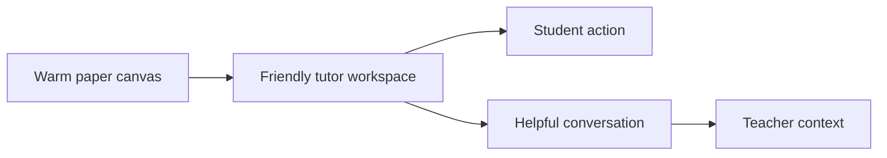

# Teachify design direction

## Direction

Warm editorial classroom. Teachify should feel like a patient tutor sitting beside the learner, not a monitoring console. References: https://teachify-483454783485.us-central1.run.app/ and https://www.khanmigo.ai/. Borrow the source product's paper-grid context, Khanmigo's guided-not-answered promise, and an editorial two-thirds workspace plus one-third helper layout.

## Palette

- Ink `#17324D` for headings and primary actions on paper.
- Paper `#FFF9EF` for the main background.
- Ochre `#D38B32` for active learning moments and focus accents.
- Moss `#3E6B57` for verified and successful states.
- Clay `#B8533E` for errors that need attention.
- Mist `#E9EFF0` for quiet surfaces and separators.
- Text on every background must meet WCAG AA contrast.

## Type

- Display: Fraunces, https://fonts.google.com/specimen/Fraunces
- Body: Manrope, https://fonts.google.com/specimen/Manrope
- Scale: 12, 14, 16, 20, 30, 48 px. Body line height 1.55. Display line height 1.02 with `-0.02em` letter spacing above 30 px.

## Space radius and line

- 8 px base scale.
- Radius: 8 px controls, 16 px major panels.
- Borders: 1 px solid `rgba(23, 50, 77, .18)`.
- Shadow: one soft shadow, `0 18px 50px rgba(23, 50, 77, .10)`, only on floating or selected panels.

## Motion

- 180 ms standard, 240 ms panels, cubic-bezier(.2,.8,.2,1).
- Animate panels from their source and progress changes. Never animate background decoration or use bounce effects.

## Icons

- Phosphor, regular weight. No emoji and no mixed icon sets.

## Imagery

- Use the real tripod render already in the product for the desk-node screen.
- Use real worksheet previews for print. No decorative stock illustrations or generated hero art.

## Copy voice

- Patient, direct, and specific.
- Ask one useful question at a time.
- Explain the next step without revealing the answer.
- Banned: seamless, elevate, unlock, revolutionize, magic, genius.

## Forbidden

- Purple or blue gradients, glass effects, glowing blobs, emoji controls, three equal feature cards, centered generic heroes, default framework colors, vague AI claims, hidden permission states, and unlabelled demo data.

## Platform

- Web tokens belong in `app/static/tokens.css` and map directly to CSS custom properties.
- Letter print tokens use black ink, white paper, and a single ochre rule.
