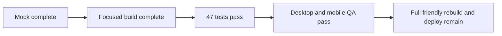

# Teachify Codex branch status

## Completed in this branch

- Added a separate `/worksheets` route with two print-ready original worksheets.
- Added Anthropic as an optional hint-wording provider after the authoritative SymPy verdict.
- Added private Deepgram temporary-token support and a public-only Vapi browser configuration route.
- Added a student `Talk it through` control with Vapi when configured and browser dictation fallback.
- Added configuration, provider, route, and secret-exposure tests.
- Created `DESIGN.md`, a full HTML mock, 375 px and desktop screenshots, and `design-qa.md`.

## Verification

- `47 passed` with one upstream Starlette deprecation warning.
- Student wrong-step hint flow passed in the browser with zero console warnings or errors.
- Worksheet route passed desktop and mobile visual inspection.
- Secret scan found none of the supplied credential patterns in tracked work.

## Remaining

- The complete existing site has not yet been restyled to the friendly mock.
- Live provider calls are unverified because no credential was written locally.
- Vapi still needs a configured assistant ID.
- Railway or Vercel deployment has not been created from this branch.
- Public demo mutation routes need a deployment access decision before wider sharing.
