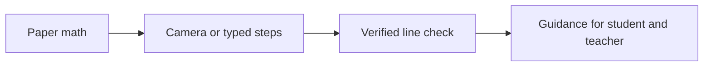

## What it does

It's 11:40 pm and Prince is on problem 7. He knows his answer is wrong. He doesn't know which line.

Going through math problems is hard, and as a past tutor, we want our kids to have the best chance of success. We loved tutoring, but there was only one of us to go around.

Teachers can't close that gap alone. They average 53 hours a week, against 44 for similar working adults (RAND 2024). Asking for help is hard too: about 40% of high schoolers regularly hesitate to admit they're confused (Character Lab Research Network, 1,000+ students).

Teachify finds the first line that went wrong and gives a hint, never the answer. It covers Algebra 1 and 2, Pre-Calc and Calculus, for middle and high school. Take this work:

$$
3(x+2) = 2x + 11 \quad\Rightarrow\quad 3x + 2 = 2x + 11 \quad\Rightarrow\quad x = 9
$$

The correct answer is \\(x = 5\\). Only the first step is wrong, and everything after it follows correctly. The tutor points at that step and stops there:

> "Look at your first step. What does the 3 multiply?"

We have one product for home and three for school:

- **Personal Tutor:** at home, a student takes a phone photo of their work and gets a hint, not the answer.
- **Enterprise A, Detect:** a desk camera watches the work, and a light turns on when a step is wrong.
- **Enterprise B, Assist:** an AI helper talks to the student over headphones.
- **Enterprise C, Quiet mode:** Teachify auto-grades the work and sends flagged lines back to the student.

About 77% of public schools ban phones in class (NCES), so the classroom products use a desk camera.

## How we built it

The app runs five steps:

1. The camera takes a photo of the work.
2. Gemini reads each line.
3. Gemini judges each line against the line above.
4. SymPy re-checks each algebra step.
5. The student gets a hint only when Gemini and SymPy agree, and never the answer.

For an equation problem \\(P\\), each line should keep the same solution set, so the first error is:

$$
k^{\ast} = \min \lbrace k : S(L_k) \neq S(P) \rbrace
$$

In the example, \\(S(P) = \lbrace 5 \rbrace\\) but the first step has solution set \\(\lbrace 9 \rbrace\\), so \\(k^{\ast} = 1\\).

We also fine-tuned our own handwriting reader: Qwen3.5-4B with a rank-16 LoRA, trained on Thinking Machines' Tinker. One epoch over 20,016 handwritten lines took 2 h 9 min and cost $1.88. The fine-tuned reader isn't wired into the live app yet.

The app is built for Google Cloud Run. Entrinsik Informer is the reporting layer, fed by a token-protected, read-only REST feed that uses seat numbers rather than names. A 3D-printed tripod holds a phone or a XIAO ESP32S3 Sense camera about 30 cm above the page, with swappable 1/4"-20 mounts and a status light. We used Claude Code to help build.

[Before submitting, state which of these ran live: Cloud Run, Entrinsik, the desk camera, the printed tripod.]

## Challenges we ran into

- **One mistake can look like many.** After the wrong step in our example, \\(x = 9\\) is correct for the line above it. Whole-page grading marks those later lines wrong anyway, so we judge each line against the one above.
- **Handwritten math is hard to read.** Even the best hosted model we tested read fewer than 6 in 10 lines exactly.
- **Phones are banned in most classrooms.** That pushed us to a desk camera and a tripod that holds it above the page.
- **A fair comparison is hard.** Our reader was trained on the same dataset's conventions as the test set, so its lead over hosted models is an upper bound.

## Accomplishments that we're proud of

Our fine-tuned reader scored highest of the models we tested on 1,000 held-out HME100K line crops, by exact match after normalisation (Wilson 95% CI where shown):

- **Qwen3.5-4B + LoRA:** 76.5% [73.8, 79.0]
- **Gemini 3.6 Flash:** 57.9% [54.8, 60.9]
- **Qwen3.5-4B base:** 52.0% [48.9, 55.1]
- **Gemini 3.5 Flash-lite:** 51.1%
- **Claude Sonnet 5.5:** 49.1%

Because of the shared dataset conventions, treat the gap over hosted models as an upper bound.

On 29 labelled images, step-by-step judging left every valid line after a mistake unflagged (18 of 18). Whole-page grading flagged them all (0 of 18 left unflagged).

## What we learned

- Judging a line against the line above stops one mistake from spreading across the page.
- A small model fine-tuned for one narrow job can be cheap: this run cost less than two dollars.
- A benchmark result needs its limits stated next to it.
- Reporting can work on seat numbers, without student names.
- [Add one thing your team learned from a teacher or from building the hardware.]

## What's next for Teachify

We want to wire the fine-tuned reader into the live app. A school pilot needs logins, a database, and a FERPA and COPPA review.
