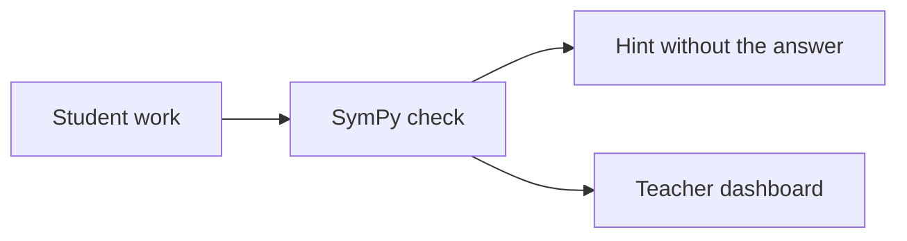

# Teachify



Catches the exact line where a student's math goes wrong, then tells the teacher who needs help and what to ask.

- **Student app** (`/student`): step-by-step work, a nudge that doesn't give the answer, XP for fixing your own mistake.
- **System A, error detection** (`app/detector.py`): SymPy finds the first invalid line and matches it to a known misconception.
- **System B, teacher brief** (`app/ai.py`, `/teacher`): Thinking Machines or Gemini words the advice. It can't change the math verdict.
- **Desk tripod** (`/node`, `hardware/`): holds a phone or camera over the student's paper, with a status light and a live 3D twin.

## Run locally

```bash
python3 -m venv .venv
.venv/bin/pip install -r requirements.txt
.venv/bin/python -m uvicorn app.main:app --port 8080
```

Open http://localhost:8080. With no keys, the app runs on its verified catalog text and labels it that way.

## Connect the AI providers

Copy the variables in `.env.example` into your environment. The app tries Thinking Machines first, then Gemini, then the catalog.

- **Thinking Machines:** Tinker serves a checkpoint you trained, so it needs a sampler checkpoint path as well as an API key.
- **Google Cloud:** run `gcloud auth application-default login` locally. On Cloud Run, the service account needs the Vertex AI User role.

## Deploy to Google Cloud Run

Class state lives in memory, so run exactly one instance.

```bash
gcloud services enable run.googleapis.com aiplatform.googleapis.com cloudbuild.googleapis.com
```

```bash
gcloud run deploy teachify --source . --region us-central1 --allow-unauthenticated --min-instances 1 --max-instances 1 --set-env-vars GOOGLE_CLOUD_PROJECT=YOUR_PROJECT
```

Put `TINKER_API_KEY` in Secret Manager rather than in a plain environment variable.

The Dockerfile should also run on any container host, including whichever platform your hackathon requires.

## Connect Entrinsik Informer

Informer pulls Teachify's results from a read-only feed. Teachify never stores Informer credentials.

| Dataset | URL | One row per |
|---|---|---|
| attempts | `/api/informer/attempts` | Checked attempt: verdict, first wrong line, misconception, self-corrected |
| alerts | `/api/informer/alerts` | Teacher alert: status, help requested, teacher rating |
| misconceptions | `/api/informer/misconceptions` | Misconception: attempts, students affected, reteach idea |

Add `?format=csv` to any URL for a spreadsheet. Rows use seat numbers such as `seat-12`, never names, and include a `simulated` column so you can filter out demo data.

1. Generate a token and store it in Secret Manager:

```bash
python3 -c "import secrets; print(secrets.token_urlsafe(32))" | tr -d '\n' | gcloud secrets create informer-token --data-file=-
```

2. Add it to the Cloud Run service:

```bash
gcloud run services update teachify --region us-central1 --update-secrets INFORMER_TOKEN=informer-token:latest
```

3. Check the feed:

```bash
curl -H "Authorization: Bearer $(gcloud secrets versions access latest --secret informer-token)" https://YOUR-SERVICE-URL/api/informer/attempts
```

4. In Informer, add a REST/API datasource for each URL, with the header `Authorization: Bearer <token>`, and set a refresh schedule. If REST setup isn't available, download the CSV and upload it as a spreadsheet datasource instead.

The feed is off (HTTP 503) until `INFORMER_TOKEN` is set. Data lives in memory, so it resets when the server restarts; a pilot should save events to a database such as Cloud SQL.

## Hardware

- **No hardware:** `python3 hardware/sim_node.py` uses the same protocol as the board.
- **ESP32:** set your Wi-Fi and server URL in `hardware/teachify_node/teachify_node.ino`, then wire a capture button to pin 3 and the WS2812 ring to pin 4. The firmware sends the press and drives the light; it doesn't take photos yet.
- **Desk tripod:** a tripod holds the camera about 30 cm above a sheet of paper. The head takes either mount with a 1/4"-20 thumbscrew, so the mounts also fit a store-bought tripod:
  - `phone_clamp.stl` grips a phone by its long edges, camera facing down. Set `PHONE_W` and `PHONE_T` in `build_model.py` to your phone and case.
  - `camera_cradle.stl` holds a Seeed XIAO ESP32S3 Sense with the lens facing down.
- **Print:** `hub`, `leg` (three times), `column`, `collar`, `diffuser` (clear or white), `yoke`, `head`, and the mount you need, all in `app/static/models/`. Parts are exported where they sit in the assembly, so lay each one flat in your slicer.
- **Hardware to buy:** 3 M3x16 bolts and nuts for the legs, an M5x25 bolt and wing nut for the tilt hinge, a 1/4"-20 thumbscrew and hex nut for the mount, and a 16-LED WS2812 ring (44.5 mm).
- **Setup:** place the paper between the two front legs. The USB cable runs down inside the column and out of the hub.
- **Change the design:** edit and rerun `hardware/build_model.py` (needs `pip install numpy trimesh manifold3d`), then bump `MODEL_VERSION` in `app/static/node.html` so browsers load the new files.

## Before real student use

This is a demo. It has no login, stores data in memory, uses synthetic names and leaves its API open. A real pilot needs authentication, a database, a FERPA and COPPA review, and vendor data agreements.

## Tests

```bash
.venv/bin/python -m pytest -q tests
```
