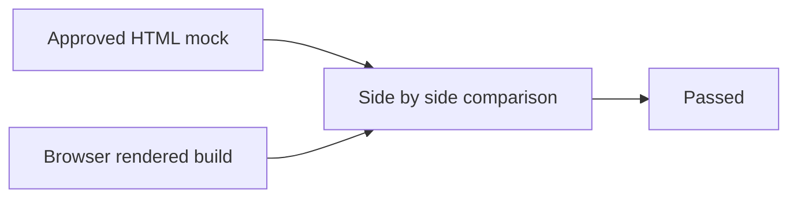

# Teachify worksheet design QA

## Evidence

- Source visual truth: `design/mocks/teachify-desktop.png` and `design/mocks/teachify-mobile.png`.
- Implementation: `design/mocks/built-worksheets-desktop.png` and `design/mocks/built-worksheets-mobile.png`.
- Combined comparison: `design/mocks/qa-comparison.png`.
- Desktop viewport: default in-app browser at 1280 px screenshot width.
- Mobile viewport: 375 by 812 CSS pixels at device scale factor 1.
- State: worksheet route loaded with both preview pages and all print actions visible.

## Fidelity surfaces

- Fonts and typography: Fraunces and Manrope match the mock. Hierarchy, weights, wrapping, and small worksheet text remain readable at both sizes.
- Spacing and layout rhythm: the built route preserves the two-page desktop layout and single-column mobile layout. Page proportions and answer spacing match the mock.
- Colors and visual tokens: warm paper, navy ink, ochre rules, mist borders, and the single soft shadow match `DESIGN.md`.
- Image quality and assets: the worksheets are native HTML and text, so they remain sharp in browser and print. No substitute imagery or placeholder assets appear.
- Copy and content: exact tagline, six original questions per page, name/date fields, and print-one or print-both actions are present. No answer key appears.

## Findings

No actionable P0, P1, or P2 visual differences remain for the worksheet scope. The built route adds a separate fractions print button, which is a useful intentional extension of the mock.

## Interaction and console checks

- Tested worksheet route at desktop and mobile widths.
- Tested the existing student mistake and hint path after integration changes.
- Browser console had no warnings or errors during the student flow.
- Native system print preview remains dependent on the user's browser and printer settings.

## Comparison history

- First pass found that the division glyph could resemble a plus at reduced scale.
- Fix: changed that prompt to `144 / 12` in both mock and build.
- Post-fix evidence: the route text and automated content test show the unambiguous slash form.

## Final result

final result: passed
